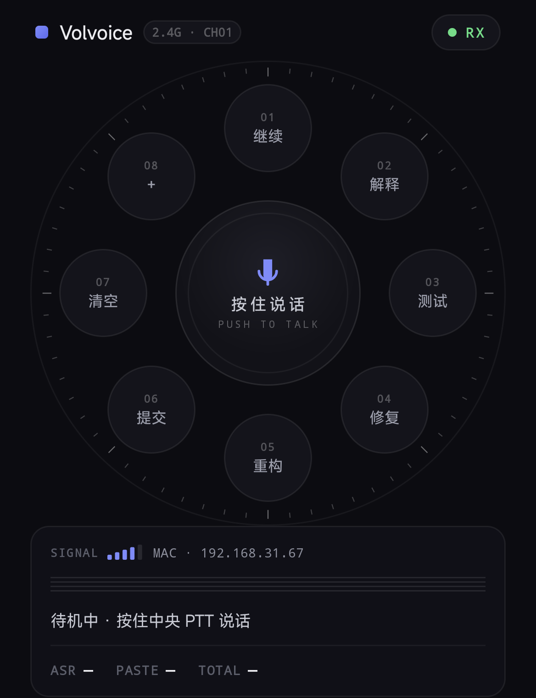
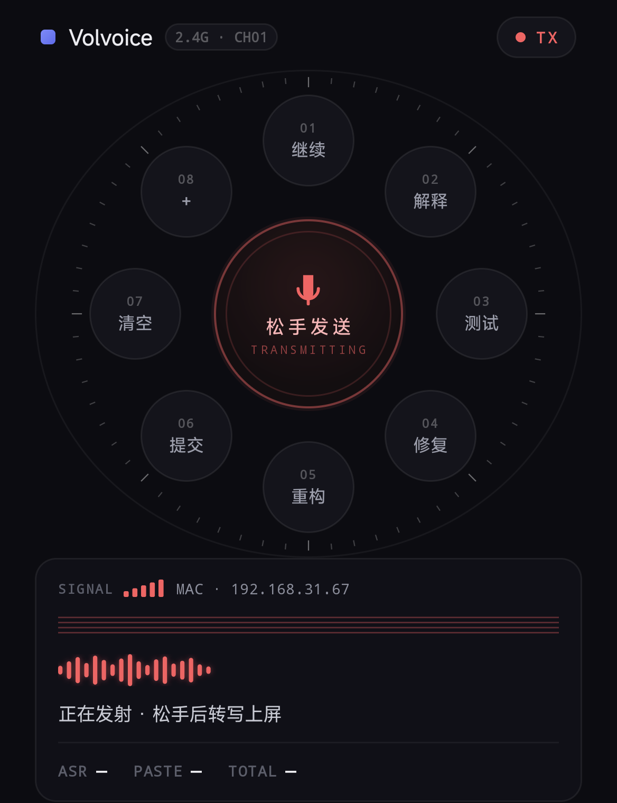
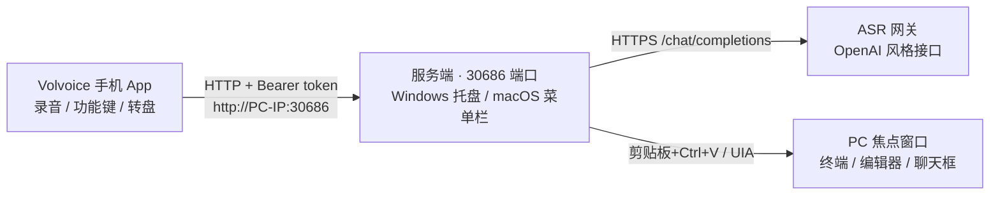

# Volvoice — 手机语音输入

> 对着手机说话，文字直接打进电脑当前聚焦的窗口——把手机变成电脑的**语音输入设备**：**按住说话 → 松手 → 文字上屏**，写代码、聊天、做笔记，动口不动手。外圈按键一键发送常用指令（"继续"、"解释"、"修复"……可自定义），转盘可拨动旋转，单手即可完成全部操作。

手机通过 **WiFi 局域网 + HTTP** 与电脑（Windows / macOS 服务端）通信，语音由电脑调用 ASR 网关（OpenAI 风格接口，如 `mimo-v2.5-asr`）转写，转写结果以剪贴板/键盘注入的方式打进焦点窗口。局域网内直连，无任何第三方遥测。

## 下载

前往 **[Releases](https://github.com/serenpax/volvoice/releases)** 直接下载，无需构建：

| 文件 | 说明 |
|---|---|
| `PC_Server.exe` | Windows 服务端（约 270KB，双击即用，无任何依赖） |
| `Volvoice-v1.0.apk` | Android 手机端（约 40KB，Android 8.0+） |

| 待机（RX） | 发射（TX） |
|---|---|
|  |  |

## 功能特性

- **按住说话**：中央大按钮 PTT，松手整段转写上屏（结果栏显示 转写/上屏/总耗时）
- **环形功能键**：8 个可自定义按键（点按发送预设文本；内容留空 = 清空输入框），**长按编辑**名称与内容
- **左轮转盘**：拇指拨动外圈旋转，带惯性、"咔哒"吸附到固定槽位（轻震动反馈），把常用键拨到顺手的位置
- **自动连接**：打开 App 自动探测服务端（`/ping`），状态灯实时显示连接状态- **对讲机状态灯**：RX 绿灯待机 / TX 红灯发射；发射时 PTT 红光呼吸、格栅发热、波形跳动
- **多电脑切换**：可保存多台电脑档案，点右上状态章一键切换（长按编辑当前电脑）
- **PC 服务端常驻**：Windows 托盘 / macOS 菜单栏（`VolvoiceServer.app`），无黑窗口，日志窗口标题即手机连接地址
- **剪贴板保护**：上屏走"备份剪贴板 → 粘贴 → 恢复"，不污染你的剪贴板
- **token 鉴权**：局域网内其他设备不知道 token 就无法让你的电脑打字

## 架构



三条链路：

1. **手机 → PC**：WiFi 局域网 HTTP（`/ping` 探活、`/transcribe` 传音频、`/text` 发文本、`/clear` 清输入框）
2. **PC → ASR 网关**：HTTPS 调用 OpenAI 风格 `/v1/chat/completions`（`input_audio` 传 WAV），连接复用 + 启动预热
3. **PC → 焦点窗口**：剪贴板备份 → 写入 → 模拟 Ctrl+V（带 PS/2 扫描码，兼容扫描码敏感应用）→ 恢复剪贴板；`/clear` 优先走 UIA ValuePattern

## 目录结构

```
volvoice/
├── PC_Server/          C++ 服务端（Windows，MinGW-w64 构建，产物约 270KB）
│   ├── main.cpp        托盘/窗口/日志（Windows 图形子系统，无控制台）
│   ├── http_server.*   HTTP 服务（keep-alive、token 鉴权、路由）
│   ├── asr.*           ASR 网关客户端（连接复用、失败重试、预热）
│   ├── text_out.*      上屏（剪贴板备份/恢复粘贴、扫描码注入、UIA 清空）
│   ├── json.*          极简 JSON 解析/序列化（含 \uXXXX 代理对）
│   └── build.ps1       一键编译脚本
├── Mac_Server/         C++ 服务端（macOS，菜单栏常驻版，零第三方依赖）
│   ├── app_main.mm     菜单栏图标 / 日志窗口 / 配置（Application Support）
│   ├── http_server.*   HTTP 服务（BSD sockets、keep-alive、token 鉴权）
│   ├── asr.*           ASR 网关客户端（libcurl，连接复用、失败重试、预热）
│   ├── http_client.*   libcurl 封装（easy handle 常驻复用）
│   ├── text_out.mm     上屏（剪贴板备份/恢复 + ⌘V 注入 + AX 清空）
│   ├── json/log/config 可移植模块（与 PC_Server 同源）
│   └── build.sh        一键编译打包 VolvoiceServer.app
└── Phone_Client/       Android 手机端（Kotlin，零第三方依赖，APK 约 50KB）
    └── app/src/main/java/com/vi/phoneclient/
        ├── MainActivity.kt   对讲机风界面（RX/TX 状态、多服务器、频道键编辑）
        ├── RadialLayout.kt   左轮转盘（物理惯性+过槽震动+咔哒吸附）
        ├── Widgets.kt        自定义部件（刻度环/格栅/波形/信号格）
        ├── PttRecorder.kt    PTT 录音（16kHz 单声道 → WAV）
        └── ServerClient.kt   HTTP 客户端
```

## 快速开始

### 1. PC 服务端

#### Windows

1. 从 Release 下载 `PC_Server.exe`（或自行构建，见下文），放到任意目录；
2. 首次运行会自动生成 `config.json` 模板并退出（也可直接创建），至少填三项：

   ```json
   {
     "token": "自己编一串随机字符（手机端填一样的值）",
     "api_base": "https://你的网关地址/v1",
     "api_key": "你的 API key"
   }
   ```

3. 再次启动——程序常驻**右下角托盘**（绿色麦克风图标，无黑窗口）：
   - **单击图标**：显示/隐藏日志窗口（标题栏就是手机要填的连接地址）
   - **点窗口 ✕**：隐藏到托盘，服务继续运行
   - **右键图标 → 退出**：真正退出
4. 手机连不上时，到 Windows 防火墙放行 `PC_Server.exe`（或 30686 端口）。

#### macOS

1. 构建或复制 `Mac_Server/VolvoiceServer.app`，双击启动——**菜单栏**出现麦克风图标（无 Dock 图标）；
2. 首次运行自动生成配置 `~/Library/Application Support/Volvoice/config.json`，填入 `api_base` / `api_key` 后重启应用（`token` 已自动生成，手机端填一样的值）；
3. 系统设置 → 隐私与安全性 → **辅助功能**，允许 VolvoiceServer（向焦点窗口注入文字需要该权限，首次上屏会自动弹授权提示）；
4. 单击菜单栏图标：显示/隐藏日志窗口（标题栏就是手机要填的连接地址）；点窗口 ✕ 只隐藏；**右键图标 → 退出**才真正退出。

> 配置与 Windows 版同一套 `config.json` 字段；建议用稳定代码签名证书签名 `.app`，否则每次重新编译都需要重新授予辅助功能权限。

### 2. 手机端

1. 从 Release 下载 APK 安装（需允许 USB 安装/未知来源）；
2. 打开 App → 右上角**设置** → 填电脑的局域网 IP、端口（默认 30686）、token → 保存（也可点状态章新增/切换多台电脑）；
3. 状态章显示 **RX 绿灯** = 已连接。**按住中央按钮说话（TX 红光），松手**，文字即打进电脑当前聚焦的窗口。

### 3. 玩法

| 操作 | 效果 |
|---|---|
| 按住中央按钮 → 松手 | 语音转文字上屏（TX 红光态，显示转写/上屏耗时） |
| 点外圈按键 | 发送该键的预设文本（或清空输入框） |
| **长按**外圈按键 | 编辑名称与内容 |
| 拇指拨动外圈 | 旋转转盘（过槽震动 + 惯性 + 咔哒吸附） |
| 点右上状态章 | 切换 / 管理多台电脑（长按编辑当前电脑） |

## 配置参考（config.json）

| 字段 | 默认值 | 说明 |
|---|---|---|
| `port` | `30686` | 服务端口 |
| `bind` | `0.0.0.0` | 监听地址（`127.0.0.1` 则仅本机） |
| `token` | 空 | **必填**。手机端鉴权口令，两端一致 |
| `api_base` | — | **必填**。ASR 网关地址（OpenAI 风格，程序自动拼 `/chat/completions`） |
| `api_key` | — | **必填**。网关 API key |
| `api_auth_style` | `bearer` | 鉴权头风格：`bearer`（Authorization: Bearer）或 `api-key`（api-key 头） |
| `api_model` | `xiaomi/mimo-v2.5-asr` | 模型名 |
| `api_language` | `auto` | 语种（`auto` / `zh` / `en`） |
| `api_timeout_ms` | `30000` | 网关超时 |
| `max_body_mb` | `25` | 单次请求体上限 |
| `log_file` | `pc_server.log` | 日志文件 |

## API 协议

所有请求走 HTTP，`POST` 类接口需携带 `Authorization: Bearer <token>`。

| 方法 | 路径 | Body | 说明 |
|---|---|---|---|
| GET | `/ping` | — | 探活，无需鉴权。返回 `{"ok":true,"service":"vi-pc-server","version":"1.1"}` |
| POST | `/transcribe` | `audio/wav`（原始 WAV 字节） | 转写并上屏。返回 `{"ok":true,"text":"…","asr_ms":338,"paste_ms":191,"elapsed_ms":529}` |
| POST | `/text` | `text/plain`（UTF-8） | 把文本上屏到焦点窗口 |
| POST | `/clear` | — | 清空焦点输入框（UIA 优先，终端走 Ctrl+U/Ctrl+K） |

curl 示例：

```bash
curl http://127.0.0.1:30686/ping

curl -X POST http://PC-IP:30686/text \
  -H "Authorization: Bearer <token>" \
  --data-binary "帮我修复这个问题"

curl -X POST http://PC-IP:30686/transcribe \
  -H "Authorization: Bearer <token>" \
  -H "Content-Type: audio/wav" \
  --data-binary "@test.wav"
```

## 从源码构建

### PC_Server（Windows）

依赖 [MinGW-w64](https://www.mingw-w64.org/)（g++ 13+，含 winhttp/uiautomationcore 头文件）：

```powershell
cd PC_Server
powershell -NoProfile -File build.ps1   # 产出 PC_Server.exe（约 270KB）
```

### Mac_Server（macOS）

依赖 Xcode Command Line Tools（clang、libcurl、AppKit 均为系统自带，无需第三方库）：

```bash
cd Mac_Server
./build.sh   # 产出 volvoice-server + VolvoiceServer.app
```

打包的 `.app` 使用「Volvoice Dev Signing」自签名证书签名（可自行创建），重编译后辅助功能授权不丢失。

### Phone_Client（Android）

Android Studio 直接打开 `Phone_Client/`，或命令行：

```powershell
cd Phone_Client

# Release 需要签名密钥（自行生成，勿提交）：
keytool -genkeypair -keystore release.keystore -alias vi-voice `
  -keyalg RSA -keysize 2048 -validity 10000 `
  -storepass vi-voice-2026 -keypass vi-voice-2026 `
  -dname "CN=Vi Voice, O=Personal"

.\gradlew assembleRelease   # 产出 app\build\outputs\apk\release\app-release.apk（约 40KB）
```

要求：JDK 17、Android SDK（compileSdk 35）、Gradle 8.9（wrapper 已附带）。App 零第三方依赖。

## 故障排查

| 现象 | 处理 |
|---|---|
| 手机显示"未连接" | 确认手机与 PC 同一 WiFi；防火墙放行；IP/端口/token 与 config.json 一致 |
| 转写失败/超时 | 检查 `api_base`/`api_key`；确认 PC 能访问网关（内网网关可能需 VPN） |
| 文字没打进窗口 | 先点一下目标窗口给它焦点；目标窗口以管理员权限运行时会拦截注入 |
| 首句特别慢 | 启动时会预热网关连接（日志有"预热完成"），属正常 |
| 想改功能键内容 | 手机上**长按**对应按键直接编辑 |

## 安全与隐私

- 语音仅在松手后整段上传到**你自己配置的** ASR 网关转写；手机与 PC 在局域网内直连；
- `config.json` 中的 `api_key` 只保存在本机，请勿上传/分享该文件；
- token 是局域网内的唯一口令，建议设置为长随机串；
- 本项目不收集任何遥测数据，不连接除你配置的 ASR 网关之外的任何服务。

## Roadmap

- [ ] 流式实时出字（边说边转写，松手上屏）
- [ ] 手机端虚拟按键（方向/回车/打断，模拟 PC 按键输入）
- [ ] 自动发现服务端（UDP 广播，免填 IP）
- [ ] 国际化（English UI）

## License

[MIT](LICENSE) © 2026 serenpax
